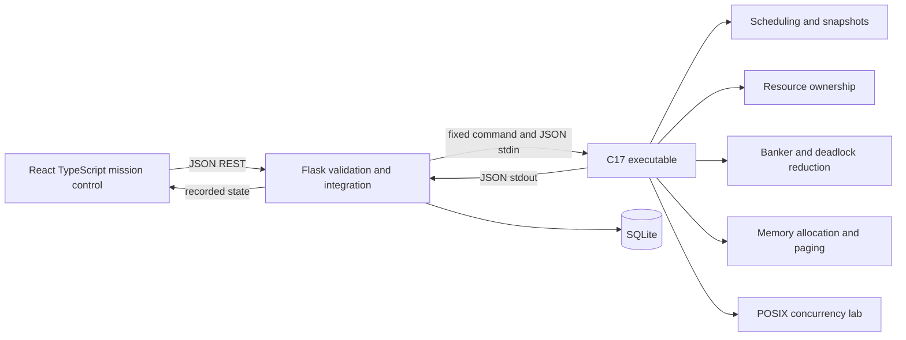
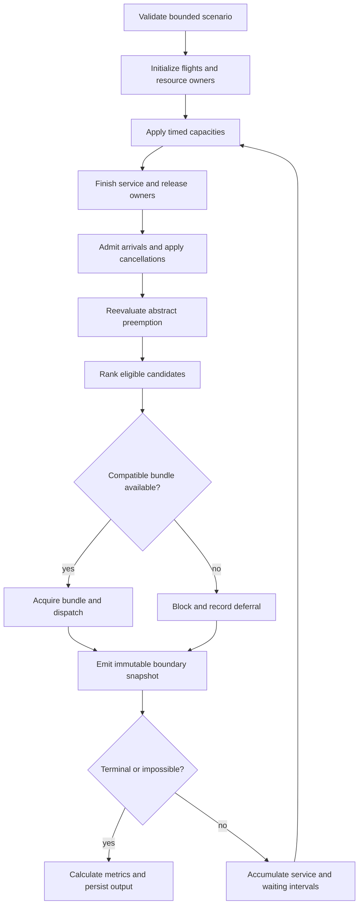
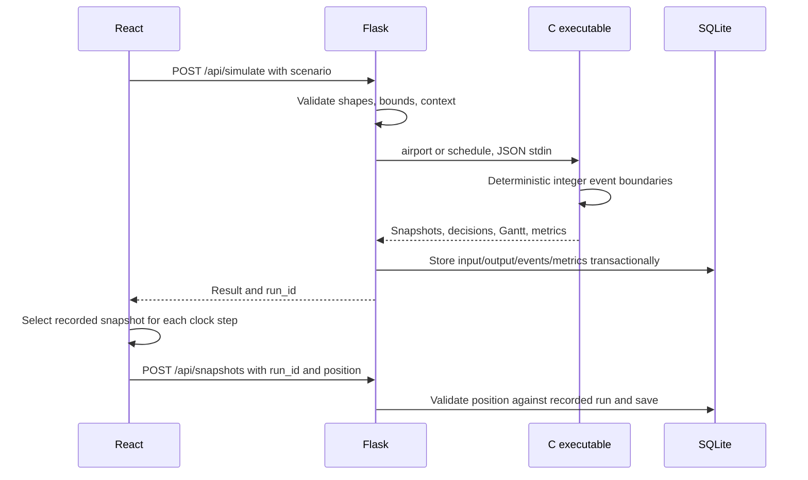

# Architecture

## Separation of responsibilities

## Simulation flow

## Module interaction

## C source modules

| File | Responsibility |
|---|---|
| `main.c` | Bounded input read, command dispatch |
| `json.c` | Tokenized JSON input access and escaped output |
| `flight.c` | PCB-inspired records, defaults, validation, state names |
| `scheduler.c` | Nine scheduling policies, deterministic airport orchestration, snapshot/event generation, timing and analytics |
| `resource_manager.c` | Slot ownership, compatibility, atomic capacity admission, owner-only release |
| `banker.c` | Safety reduction, requests/rollback, multi-instance detection, graph dependencies, victim recovery |
| `memory_manager.c` | Variable partition allocation, coalescing/compaction, frame policies and translation |
| `synchronization.c` | Real pthread workers and POSIX locks/semaphores |
| `model_checker.c` | Independent finite-plan BFS, state deduplication, invariant checks, shortest traces and shield comparison |

The proposed separate `simulation.c` and `analytics.c` responsibilities are kept in `scheduler.c` so a single boundary loop owns timing. Banker and deadlock share the Work/Finish reduction implementation. Header `aero.h` exposes the common record/protocol and resource API. Each request invokes a fresh process, isolating module globals and crashes. The timeline uses dynamically allocated C storage and frees it on normal completion.

## Data structures and time semantics

Flights live in bounded PCB arrays. Ready/waiting/completed queues are logical indexed sets derived from state rather than linked lists. RR and MLFQ use enqueue stamps. Resource ownership is a resource-class/slot matrix containing process indices or −1. Admission scans a complete bundle before mutating ownership. Matrices have at most 100 process rows and six resource columns. Memory uses a dynamic partition list represented by bounded block arrays. POSIX producer/consumer uses a 16-element circular buffer.

At time t, completion at the boundary precedes admissions and dispatch. A snapshot records the resulting state **before** execution over [t,t+1). Remaining work decreases only for RUNNING processes during this interval. Waiting increments only for READY/BLOCKED processes. A completion snapshot therefore shows remaining=0, completion=t, and all owned slots released. Backward navigation is an array lookup, not reverse mutation.

## Persistence

`scenarios`: validated JSON configurations. `runs`: kind/name/input/output/UTC timestamp. `events`: run FK, simulated timestamp, JSON decision. `metrics`: run FK, aggregate JSON. `snapshots`: name/run FK/validated position/UTC timestamp. SQLite connection scopes commit or roll back and always close. Experiments and arena results use the same run archive, preserving exact inputs.

## API

| Route | Operation |
|---|---|
| GET `/api/bootstrap` | Defaults, built-in names, algorithms, saved scenarios, lab presets |
| GET `/api/scenario?name=…&seed=42` | Reproducible workload generation |
| POST `/api/simulate` | Run airport or abstract scheduler |
| POST `/api/battle` | Identical one-CPU policy comparison |
| POST `/api/experiment` | Baseline and modified paired runs |
| POST `/api/lab/banker`, `/deadlock`, `/memory`, `/sync` | Run independent C lab; memory supports `compare=true` |
| GET/POST `/api/scenarios` | List/save configurations |
| GET/DELETE `/api/scenarios/<id>` | Load/delete configuration |
| GET `/api/history`, `/api/runs/<id>` | List/reopen recorded outputs |
| GET/POST `/api/snapshots` | List/save validated replay positions |
| GET `/api/reports/<id>?format=md|json|csv` | Export a measured result |

JSON errors return 400; foreign origins/hosts 403; absent records 404; C timeouts 408; oversized requests 413. No C command or executable path is supplied by an HTTP client.

## October 26 extension

The active five-folder desktop adds `model_checker.c` and `POST /api/verify`. The verifier is an independent finite resource-plan model, not the airport engine. Inputs and output graphs/traces persist as `modelcheck` runs. Current scope and claims are in `audit-2026-10-26.md` and `beyond-syllabus.md`.
